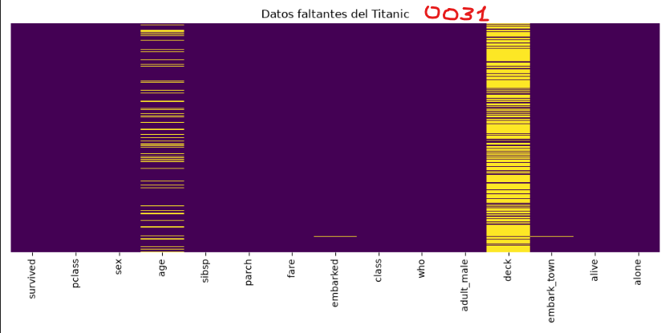
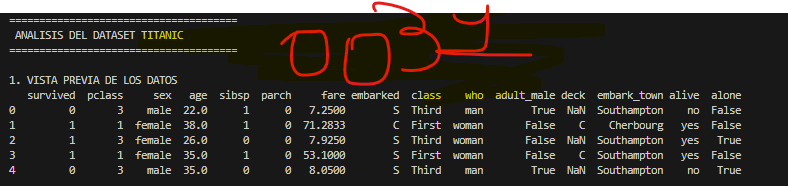
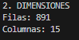
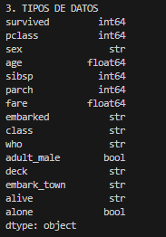
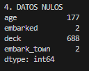
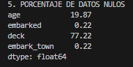
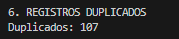
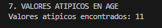
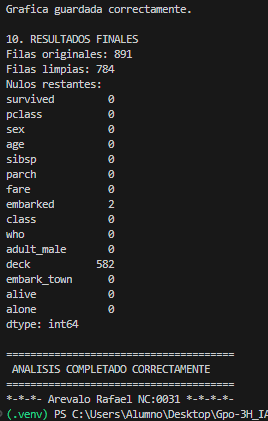

## Arevalo Rafael NC:0031
## Caso 1 Titanic:

## Resultados del codigo 

## Vista previa de datos

## Dimenciones

## Tipos de datos

## Datos nulos

## Porcentaje de datos nulos

## Registros duplicados

## Valores atipipcos en AGE 

## Grafica guardada correctamente 

# 🕵️‍♂️ Práctica: Identificación de Problemas en los Datos

> **⏱️ Duración:** 2 horas  
> **🎯 Nivel:** Cero a principiante  
> **🤖 Área:** Machine Learning (Data Cleaning)  
> **💻 Herramientas:** Python, VS Code, Pandas, NumPy, Seaborn  

---

## 🎯 Propósito de la Práctica
Que los estudiantes aprendan a revisar conjuntos de datos (*datasets*) e identifiquen los problemas más comunes que pueden arruinar el entrenamiento de un modelo de Machine Learning. 

Trabajaremos con dos escenarios reales:
1. **Caso 1: Pasajeros del Titanic** 🚢 (Detección de problemas reales: nulos, duplicados, tipos y atípicos).
2. **Caso 2: Flores Iris** 🌸 (Detección de problemas simulados para aprender a depurar).

---

## 🧠 1. Conceptos Básicos

Antes de tocar el código, es fundamental entender los "4 jinetes del apocalipsis" de los datos:

| 🚨 Problema | 📝 Descripción | 💡 Ejemplo |
| :--- | :--- | :--- |
| **Datos nulos** | Información que no está registrada o es desconocida. | El campo "Edad" está vacío. |
| **Duplicados** | Registros idénticos repetidos, lo que sesga el modelo. | Dos filas con el mismo ID y datos. |
| **Tipos incorrectos** | Datos almacenados con un formato inadecuado. | La edad guardada como texto `"25"` en lugar de número `25`. |
| **Valores atípicos** | Valores extremos que se alejan del comportamiento habitual. | Una edad registrada como `250` años. |

> 💬 **Pregunta para iniciar la clase:**  
> *¿Qué creen que sucedería si entrenamos una IA para predecir supervivencia usando datos con edades de 250 años o campos vacíos?*

---

## 🛠️ 2. Preparación del Entorno de Trabajo

### Paso 1. Crear la carpeta principal
1. Crea una carpeta en tu escritorio llamada: `identificar-problemas-datos-0777`
2. Abre **Visual Studio Code**.
3. Ve a **Archivo → Abrir carpeta** y selecciona la carpeta creada.

### Paso 2. Estructura de archivos
Tu explorador de VS Code debe verse así (crea las carpetas y archivos vacíos): 
```text
identificar-problemas-datos-0777/
│
├── .venv/                     # (Se generará en el Paso 3)
│
├── caso1-titanic/
│   ├── datos/
│   │   └── titanic.csv        # (Se descargará en el Paso 3 del Caso 1)
│   ├── resultados/            # (Carpeta vacía para guardar salidas)
│   └── analizar_titanic.py    # (Tu código)
│
├── caso2-iris/
│   ├── datos/
│   │   └── iris.csv           # (Se descargará en el Paso 1 del Caso 2)
│   ├── resultados/            # (Carpeta vacía)
│   └── analizar_iris.py       # (Tu código)
│
└── requirements.txt           # (Dependencias del proyecto)

---
